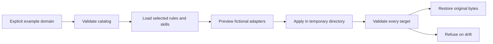

# Agent Engineering Toolkit

Give an engineering agent the rules it needs for a task, and make configuration changes inspectable and recoverable.

## The engineering project

The underlying toolkit brings shared engineering rules, reusable skills, and configuration management to **Claude Code, Codex, OpenCode, and Antigravity**. Common principles live in one place; each runtime has an adapter for its own configuration and lifecycle.

Three design choices make the system interesting: a compact core with task-specific instruction loading, generated skill catalogs that catch missing or stale references, and a staged configuration workflow that separates preview, application, and recovery. Task classification remains instruction-guided; the catalog and migration checks are implemented in code.

The full implementation and personal operating configuration remain private. This repository explains the architecture and exposes a small executable slice for inspection.

## Run the public reference demo

This is a **newly authored public reference implementation with synthetic inputs**, inspired by a private agent-tooling project's architecture. It demonstrates a small, explicit workflow: select example rules and skills, preview two fictional adapter configurations, apply them, and recover from a deliberately injected failure. It is a runnable engineering sample, with no dependencies or provider access.

```sh
python3 demo.py
python3 -m unittest discover -s tests -v
```

Requires Python 3.10+. Run commands from this directory. Nothing needs to be installed.

## What to look for

- **Selective context:** an explicitly supplied `backend` domain loads common, backend, and security rules plus two relevant skills. Unsupported domains load nothing.
- **Catalog integrity:** generated skill references must exist; changed catalog content is detected before supported-domain loading.
- **Inspectable changes:** preview reports intended changes without writing files. Apply affects only two fixed example configuration filenames and preserves an unmanaged note.
- **Recovery with boundaries:** repeated apply is a no-op. Injected failures restore original bytes and remove newly created managed files. A synthetic external edit makes rollback refuse before restoring any file.



The private project's task classification and selective loading are **instruction-guided**. This demo's domain lookup is deterministic; it does not classify natural-language tasks or run an LLM. Catalog generation, missing-reference checks, and staleness detection are code-enforced principles. No token savings or business outcomes were measured.

For machine-readable evidence, run `python3 demo.py --json`. The committed [example output](artifacts/demo-output.json) comes from an actual local execution; all evidence is synthetic and uses logical filenames. Each run uses fresh temporary directories and cleans them on exit. No CLI option accepts a target directory.

Start with the [walkthrough](docs/demo-walkthrough.md), then explore the [architecture](docs/architecture.md), [design decisions](docs/design-decisions.md), and [evidence and limits](docs/evidence-and-limits.md).
