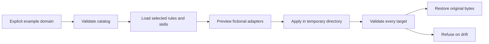

# Agent Engineering Toolkit

**Shared engineering rules and recoverable configuration for AI coding tools.**

I built this toolkit to keep engineering rules, reusable skills, and configuration consistent across **Claude Code, Codex, OpenCode, and Antigravity**.

The problem is practical: each tool has its own instruction format and configuration. Maintaining them separately can leave rules out of sync and make setup changes hard to trace or undo. The toolkit puts common rules in one place, gives each runtime an adapter, and separates configuration previews from application and recovery.

**Private implementation · Public architecture and runnable reference demo.**

## What I built

- **A shared rule system:** a compact common core, with domain-specific guidance and selected skills loaded for the task. Task classification and selection are instruction-guided.
- **Generated skill catalogs:** a generator validates skill references and provides a check for stale generated content.
- **Runtime-specific adapters:** shared engineering principles map to each coding tool’s own configuration and lifecycle.
- **A recoverable configuration workflow:** preview changes, apply them through a staged process, and validate targets before rollback so later edits are not silently overwritten.

The full implementation and personal operating configuration remain private. The architecture documents explain these design choices; the example below lets you inspect selected behaviors without accessing that environment.

## Run the public reference demo

The reference demo selects example rules and skills, previews two fictional adapter configurations, applies changes, and restores the original state after an injected failure. It also shows rollback refusing to overwrite a later edit.

This is a separately authored example with **synthetic inputs**, not the private implementation or a real vendor installer. It runs in fresh temporary directories and needs no external dependencies or provider access.

```sh
python3 demo.py
python3 -m unittest discover -s tests -v
```

Requires Python 3.10+. Run commands from this directory. Nothing needs to be installed.

## What to look for

- **Selective context:** an explicitly supplied `backend` domain loads common, backend, and security rules plus two relevant skills. Unsupported domains load nothing.
- **Catalog integrity:** generated skill references must exist; changed catalog content is detected before supported-domain loading.
- **Inspectable changes:** preview reports intended changes without writing files. Apply affects only two fixed example configuration filenames and preserves an unmanaged note.
- **Recovery with boundaries:** repeated apply is a no-op. Injected failures restore original bytes and remove newly created managed files. A synthetic external edit makes rollback refuse before restoring any file.



The private project's task classification and selective loading are **instruction-guided**. This demo's domain lookup is deterministic; it does not classify natural-language tasks or run an LLM. Catalog generation, missing-reference checks, and staleness detection are code-enforced principles. No token savings or business outcomes were measured.

For machine-readable evidence, run `python3 demo.py --json`. The committed [example output](artifacts/demo-output.json) comes from an actual local execution; all evidence is synthetic and uses logical filenames. Each run uses fresh temporary directories and cleans them on exit. No CLI option accepts a target directory.

Start with the [walkthrough](docs/demo-walkthrough.md), then explore the [architecture](docs/architecture.md), [design decisions](docs/design-decisions.md), and [evidence and limits](docs/evidence-and-limits.md).
