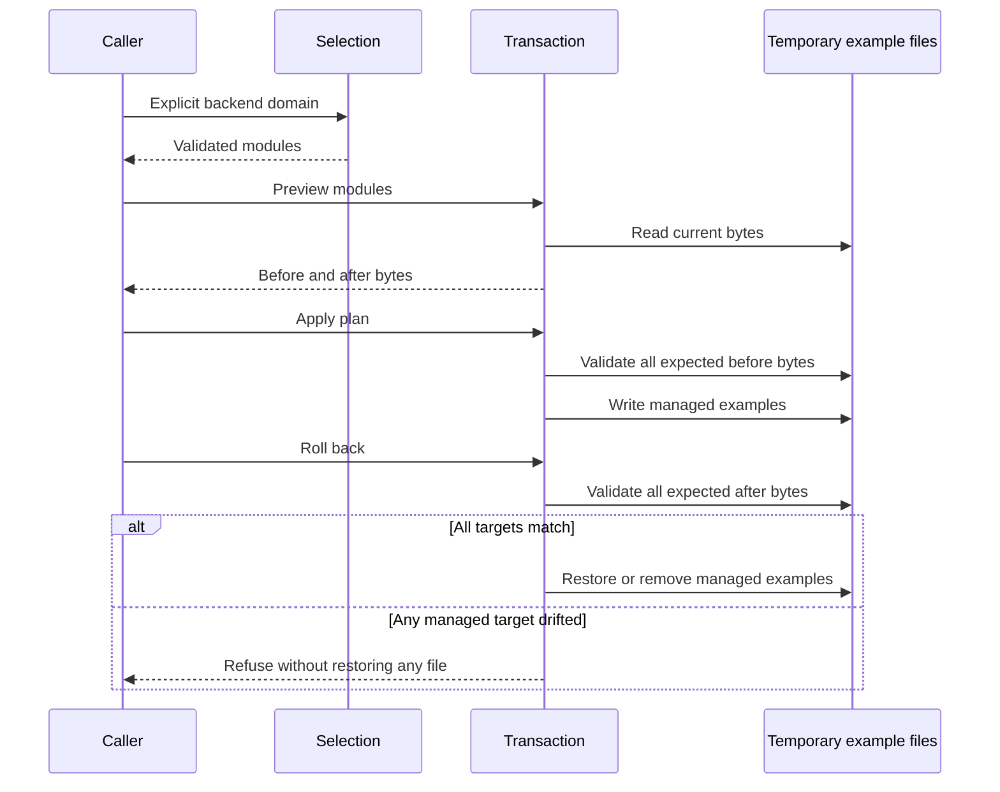

# Architecture

The architectural problem has two parts: selecting relevant instructions without loading every domain, and changing runtime-specific configuration without losing track of the prior state. This public sample keeps those concerns separate.

## Rules, catalogs, and selection

The inspected private architecture uses common rules plus task-domain instructions. The agent follows instructions to identify relevant domains, consults a generated catalog, and loads selected skill bodies. Classification and selective loading are instruction-guided, rather than an autonomous classification service. Catalog generation verifies missing skill references and detects stale generated artifacts in code.

The reference demo takes a caller-supplied `backend` identifier. A small selection table names three rules and two skills. `generate_catalog` validates skill identifiers and references, then produces deterministic catalog rows. `check_catalog` compares that generated result with a supplied snapshot. `load_domain` validates the identifier, returns an explicit unsupported outcome for unknown domains, and loads content only after supported-domain catalog validation. Catalog descriptions are metadata; skill bodies are loaded from the example registry after selection.

This is an in-memory model of catalog integrity. It does not scan a skill tree or generate real harness catalogs. Adding a new example domain would require deliberately authoring its rules and selection table.

## Fictional adapter boundary

`ADAPTERS` maps two fictional adapter identifiers to fixed filenames. Their JSON schema records module identifiers and a visibly fictional schema name. These files cannot be used to install or configure a vendor product. The adapter boundary illustrates translating one selection into runtime-specific outputs; it is not a production registry.

## Transaction state

A `Change` holds an adapter identifier, exact original bytes (or absence), and desired bytes. Preview creates these records without mutation. Apply validates the complete plan before starting writes and records each attempted write in an in-memory journal. A second transaction sees an empty plan when desired bytes already match.

Rollback first compares **every journaled target** with its expected applied bytes. Only after all comparisons succeed does it restore original bytes, removing files that were originally absent. A synthetic edit to the target restored last demonstrates why validation must finish before restoration starts: the other target remains untouched too.

A deliberately injected exception occurs after a complete managed-file write; the handler invokes rollback. This bounded behavior does not promise recovery from partial disk writes, restoration errors, process termination, concurrent writers, or power loss. The journal is not durable.

## Improvement loop

The private architecture also uses human-reviewed improvement proposals: observations become proposed rule or skill changes, and a person reviews them before adoption. This is an architectural principle described here, not an automated feature in the public sample. The demo neither collects session history nor modifies its own instructions.
